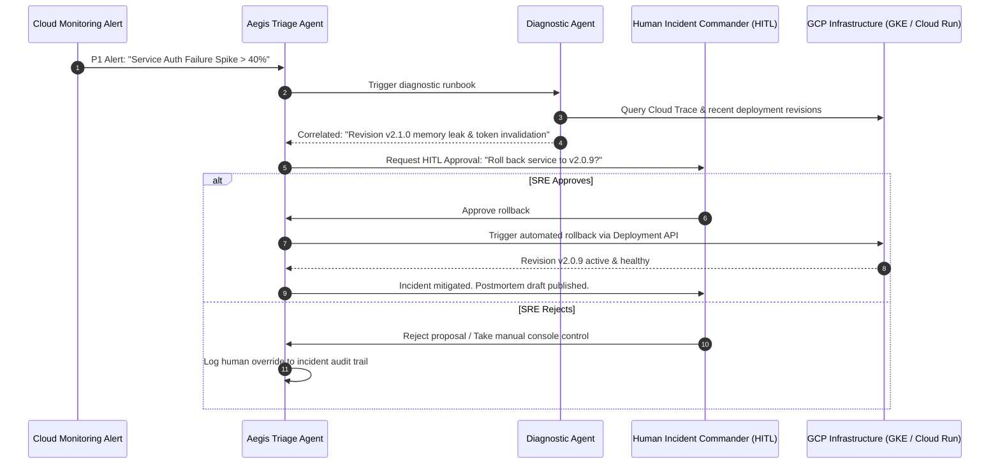

# Module 40 Enterprise Playbook: Aegis Incident Response & Autonomous Remediation

The Chief Information Security Officer (CISO) and Principal Site Reliability Engineer (SRE) need this result: A multi-agent autonomous incident triage and remediation engine (Project Aegis) that detects anomalous telemetry, isolates compromised cloud infrastructure, synthesizes root-cause postmortems, and enforces strict Human-in-the-Loop (HITL) authorization gates for destructive operational commands.

Read the [plain-English task and term explanations](./README.md) before reviewing the implementation details.

## 1. Project Aegis Architecture & Incident Triage Stages

Autonomous incident response requires a disciplined progression through detection, investigation, containment, and postmortem analysis to avoid compounding outages.

| Incident Stage | Aegis Agent Role | Operational Controls & Guardrails |
|---|---|---|
| Stage 1: Detection & Ingestion | Telemetry Ingestion Agent | Subscribes to Cloud Monitoring alerts and Cloud Logging anomaly topics via Pub/Sub. |
| Stage 2: Diagnostic Corroboration | Root Cause Investigator | Queries Cloud Trace, BigQuery audit logs, and metrics; cross-correlates error spikes with recent canary deployments. |
| Stage 3: Containment Proposal | Remediation Strategist | Generates targeted containment plan (e.g., firewall rule update, pod quarantine, canary rollback). |
| Stage 4: Consequential Gate | Human Incident Commander | Mandatory HITL approval via PagerDuty / Slack interactive modal before any mutation is applied. |
| Stage 5: Execution & Verification | Safe Executor Agent | Applies idempotent remediation via Cloud Run / GKE APIs; verifies latency recovery before closing alert. |

## 2. Aegis Incident Response Orchestration Flow

## 3. Production Hardening & Safe Remediation Principles

1. **Non-Destructive Defaults:** Automated tools must default to read-only diagnostic queries. Any state-mutating command (quarantine, restart, delete, rollback) must require explicit dual-control sign-off.
2. **Blast-Radius Containment:** Ensure the agent's service account has IAM permissions restricted strictly to the targeted microservice workload, never granting broad project-level `Owner` or `Editor` roles.
3. **Automated Postmortem Generation:** On incident resolution, generate a standardized blameless postmortem artifact documenting detection time, time-to-mitigate (TTM), affected user percentage, and root cause timeline.

<!-- © 2026 Inder Chauhan (https://github.com/inderanz/google-adk-training). All rights reserved. Ref: IC-ADK-module40-aegis-incident-response-enterprise-playbook -->

